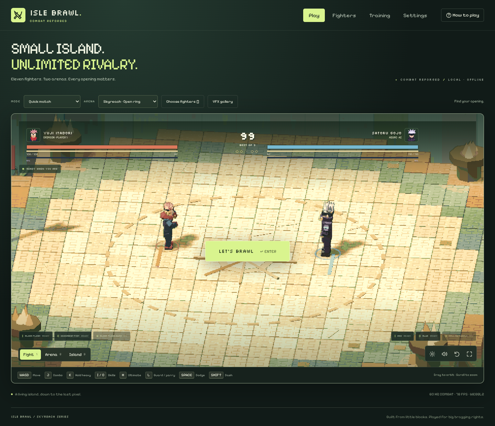
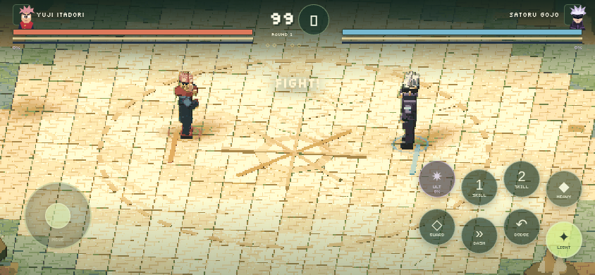
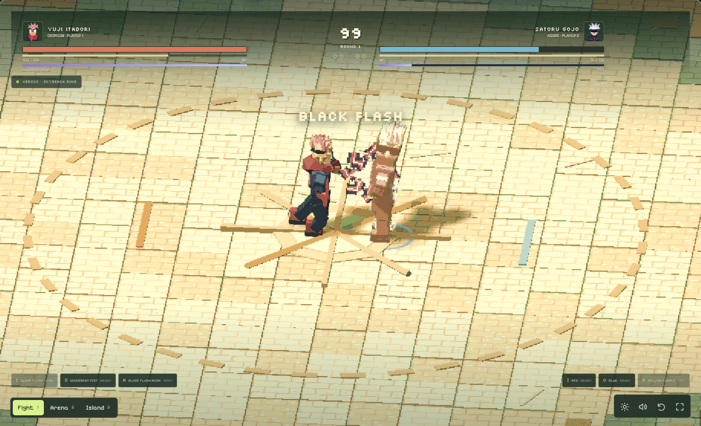
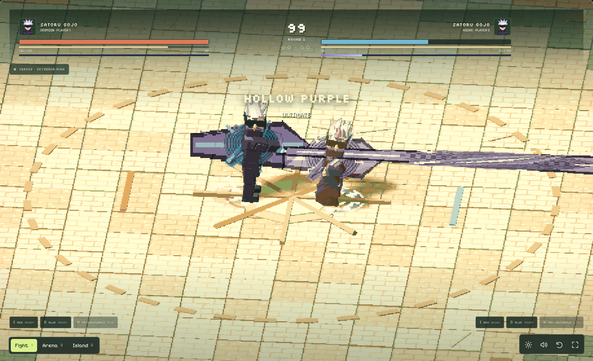
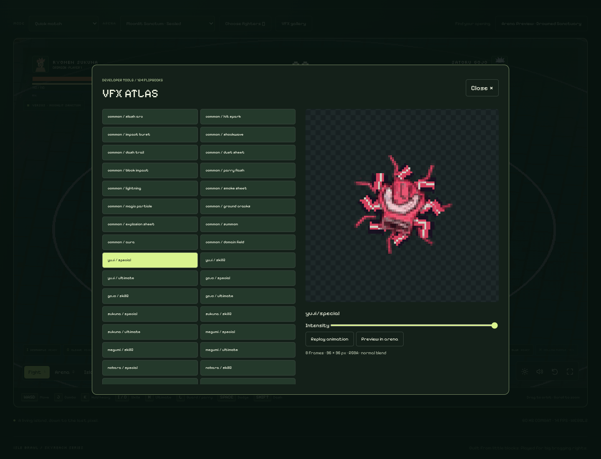

# ISLE BRAWL: COMBAT REFORGED

An offline 3D arena fighter set above a living island. Eleven fighters, 1v1/2v2, two arena rulesets, two signature skills and one ultimate per fighter. Open **index.html** directly in a modern browser; the production game has no backend, install step or external asset requests.



## Play

Choose **Play**, **Fighters**, **Training** or **Settings** in the main menu. The fighter drawer edits any of the four team slots and shows fighting style and signature skills. Configuration closes when the fight starts. Quick Match preserves 1v1 and 2v2; controller assignments support keyboard, gamepads and AI.

| Action | Player 1 | Player 2 | Gamepad |
| --- | --- | --- | --- |
| Move | WASD | Arrows | Left stick |
| Light combo | J | Comma / numpad 1 | X |
| Heavy / charge | Hold K, release | Hold period / numpad 2 | Hold Y, release |
| Signature 1 | I | Semicolon / numpad 5 | B |
| Signature 2 | O | Quote | Right trigger |
| Ultimate | H | Right bracket | Left trigger |
| Guard / timed parry | L | Slash / numpad 3 | Either bumper |
| Dodge | Space | Right Shift / numpad 0 | A |
| Dash (no invulnerability) | Left Shift | Right Control | Left stick click |

Enter starts/rematches; P pauses; M mutes. Touch provides a stick and all eight combat actions, including hold-to-charge. Gamepad labels follow the standard browser mapping. Physical controller feel still needs hands-on testing.

## Mobile Landscape Edition

On phones, choose fighters and settings in portrait, then start a match and rotate to landscape. Combat fills the available screen with a compact HUD, safe-area-aware joystick and eight circular action targets. Fullscreen/orientation lock are attempted when supported; the rotate prompt provides a fallback. Use the top-center pause button to resume, restart, change controls or return to the menu.

Mobile Controls stores joystick/button sizing, spacing, opacity, handedness, floating joystick, shake, VFX intensity, FPS and graphics preferences locally. Low, Medium, High and Auto change rendering budgets while combat stays at 60 Hz. Two-finger movement plus attacks, guard or heavy charge share one pointer ownership system.



See [mobile implementation and device-testing limits](docs/mobile-landscape.md). Run `node tests/mobile-layout.cjs` for all five landscape sizes, both portrait sizes, simultaneous touch actions, rotation, settings and rematch resource checks. These are desktop-emulated tests; physical phone rotation and hardware FPS still require real-device review.

## Combat rules

- Simulation remains deterministic at **60 Hz**, independent of textures, particles, camera, audio and rendering frame rate.
- Every registered attack has startup, active and recovery frames, a geometric hitbox, cost, damage, knockback, animation, event names and cooldown. There are **77 entries**: three light stages, heavy, two skills and ultimate for each fighter.
- Hold heavy for up to 45 charge frames. Releasing begins the attack's startup; maximum charge adds 55% damage. You remain vulnerable while charging.
- Guard during the five frames before contact to parry a non-ultimate attack. A successful parry costs 12 stamina, staggers the attacker and gives a 40-frame counter window with 15% bonus damage on the next attack.
- A confirmed light hit may cancel recovery into either signature skill, or into a dodge for 30 stamina. Whiffs cannot use this cancel. Light chains retain their defined input windows; inputs buffer for 12 frames.
- Repeated hits scale down to 40% damage. Extended chains force knockdown, followed by invulnerable get-up. Downed targets cannot be farmed for meter.
- Ultimates require **100 energy and 25 stamina**. Landed attacks, received damage and successful parries earn energy. Ultimates do not refund energy from their own damage; cooldown and energy gates both apply.
- Projectiles travel and use swept contact checks. Ground fields have explicit release timing and radius. VFX never causes damage.

| Fighter | Identity | Signature 1 / 2 | Ultimate |
| --- | --- | --- | --- |
| Yuji | Close-range pressure; delayed second pulse | Black Flash / Divergent Fist | Black Flash Rush |
| Gojo | Pull, repel, narrow long-range beam | Red / Blue | Hollow Purple |
| Sukuna | Extended slashes and broad arcs | Dismantle / Cleave | Malevolent Shrine |
| Megumi | Dog lunge and delayed ground snare | Divine Dog / Shadow Snare | Chimera Shadow Garden |
| Nobara | Traveling nail marks amplify Resonance | Resonance / Nail Volley | Straw Doll Resonance |
| Toji | Fast weapon pressure and chain reach | Heavenly Rush / Chain of a Thousand Miles | Heavenly Execution |
| Kenjaku | Swarm pressure and radial attraction | Cursed Swarm / Gravity Well | Womb Profusion |
| Geto | Staff pressure and traveling spirits | Uzumaki / Cursed Spirit | Maximum Uzumaki |
| Mahito | Close touch and extended linear strike | Soul Touch / Transfiguration | Self Embodiment |
| Grinsk | Agile mace strings and invulnerable feint startup | Leap Smash / Mischief Rush | Emerald Mayhem |
| Bonewarden | Efficient defense and ranged spectral edge | Shield Bash / Spectral Edge | Last Watch |

Summons are synchronized attack shapes/projectiles, not independently controlled persistent allies. Domains are area attacks with anticipation and recovery, not permanent arenas. Gameplay numbers are tuning choices, not canonical power rankings.

## Modes and arenas

- **Quick Match:** 1v1 or 2v2, AI/controller selection, difficulty and round count.
- **Local Versus:** two local players in a duel; keyboard or two gamepads.
- **Arcade:** ten opponents, one round per encounter, increasing AI difficulty. Continue after each win; loss ends the run.
- **Survival:** five escalating waves. Health carries forward; a victory restores up to 24 HP. Win wave five or lose to finish the run.
- **Training:** stand/guard/attack/evade dummy, hitbox overlays (startup green, active red), frame data, combo/damage totals, unlimited resources/cooldown testing, reset and explicit finish-session controls.
- **Skyreach:** original open ring and ring-outs. **Moonlit Sanctum:** night lighting, etched floor and a visible sealed perimeter that bounces fighters. Decorative world meshes never enter collision detection.

The island retains instanced villagers, birds, moving clouds, windmills, banners, lights and waterfalls, with a new animated ocean beneath it. Crowds and boundary lighting react to impacts.

## Presentation and accessibility

Procedural eighteen-bone fighters retain the original identities and accessories. Beveled clothing, distinct weight distributions, phase-aligned attack poses, signature casting poses, dash/charge motion and cached IK extend the existing planted-foot rig. Rendering uses palette quantization, outlines, a restrained highlight halo, contact shadows and soft shadows.

The feedback system combines hitstop, directional shake, brief camera zoom, hit flashes, screen-edge feedback and layered procedural audio. Final knockouts retain slow motion. Settings expose shake, flashes, particle density, high/low/adaptive quality, and separate music/SFX/UI volume. Adaptive mode reduces resolution and disables expensive shadows after sustained low frame rates; it never changes combat timing.

The developer **VFX Gallery** previews every shipped texture, shows frame metadata and provides intensity/replay/arena-preview controls.





## Source and offline build

The generated `index.html` is the distributable; edit `src/`, not generated HTML.

```
src/fighters/   roster, normalized skill registry, procedural models
src/combat/     fixed-tick state machine, contacts, resources, AI
src/input/      pointer ownership, joystick and multi-touch controls
src/animation/  keyed poses, foot anchors, cached IK
src/vfx/        manifest loader, sprite animator, fixed-capacity pool,
               projectile/trail/particle/impact/ground/ultimate effects
src/audio/      feedback and procedural audio mix
src/game/       island, renderer, input, mode flows and presentation integration
src/ui/         shell and responsive styling
assets/vfx/    49 original RGBA flipbooks and 77 skill bindings
vendor/        bundled Three.js r128, MIT license retained
```

```sh
node tools/build.cjs          # no dependency installation needed
python3 -m http.server 3180   # optional local development server
```

The builder inlines scripts, fonts, the registry and all PNGs. It uses Node built-ins and does not fetch anything. Asset regeneration requires Python and Pillow (`pip install Pillow`):

```sh
python3 tools/generate-vfx.py
node tools/build.cjs
```

Vercel uses the committed `vercel.json`: no framework preset, a dependency-free build, and `public` as the output directory. `node tools/build.cjs --out-dir public` publishes the same self-contained game as `public/index.html`; the default build still writes the downloadable root `index.html`. The generated `public/` directory is ignored by Git. Run `node tests/deployment.cjs` to verify the host build in an isolated directory and smoke-test the served output with Chromium.

The deterministic generator draws eight-frame, 96px RGBA tiles with four-pixel transparent gutters. Nearest filtering, clamped atlas UVs, no mipmaps, depth-write disabled and per-asset blending prevent rectangular borders and bleeding. Assets are used by live effects or explicitly available in the gallery. Render effects recycle a fixed pool of 96 meshes/materials; IK reuses solver vectors and quaternions.

## Verification

```sh
npm test                         # mechanics + Reforged + 500 roster matches
python3 tests/vfx-assets.py       # PNG dimensions, alpha and every frame gutter
npm install                      # Playwright is development-only
npm run test:browser              # offline Chromium, no server required
node tests/mobile-layout.cjs      # touch actions and wrapped navigation geometry
```

Set `CHROMIUM_PATH` if Chromium is not `/usr/bin/chromium`. Additional retained regressions: `tests/sorcerers.cjs`, `new-pair.cjs`, `balance.cjs`, `matchups.cjs`; legacy browser tests use the local server on port 3180 and write to ignored `test-results/legacy/`. Legacy roster assertions were updated to eleven while preserving their original fighter-specific checks.

Current executed simulation checks: all 77 attacks, charge, parry, confirmed-hit cancels, stamina/cooldown gates, ultimate anti-refund, combo scaling, projectile timing, beam shape, wall interactions, training reset, deterministic replay and asset resolution. **9,632 seeded AI matches** completed across the current and retained suites without a stuck match. Historical reports in `docs/baseline.md` describe the old build, not current balance guarantees.

Browser results and review screenshots live in `tests/reforged-browser-results.json` and `docs/screenshots/`. The browser suite covers all eleven rigs and 55 key attack poses, full matches, mode transitions, keyboard, mobile overflow, asset loading and zero network requests in the offline build. Progression terminal paths additionally use explicit result fixtures; these are distinguished from the full AI match tests in the harness.

## Known limits

- Three.js **r128 is retained**, rather than upgrading the dependency during the combat rewrite. The current renderer uses WebGL2 when available and falls back to WebGL. A newer Three.js migration is separate work.
- These remain procedural stylized rigs, not imported/scanned characters. Some foot repositioning and accessory overlap can occur during extreme direction changes; no claim of cinematic mocap fidelity is made.
- Ultimates use distinct casting/attack geometry and effects with a brief zoom, rather than bespoke multi-shot cinematics per fighter. Domain effects do not deform terrain.
- Smoke/dust and effects are pooled, but some original world/animation code still allocates temporary vectors. Software-rendered headless Chromium is **not a 60 FPS hardware benchmark**. Desktop GPU and real phone profiling remain necessary.
- AI can finish matches and uses range, recovery, stamina and defensive cues. Balance is initial tuning; seeded completion tests do not prove competitive matchup parity.
- Cosmetics, persistent unlocks and online systems are not included. Core play and offline operation take priority.

See [implementation audit and plan](docs/implementation-plan.md) for the baseline decisions.
