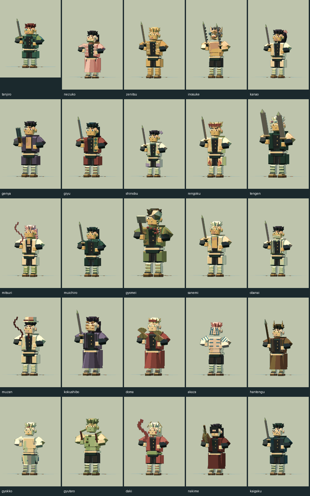
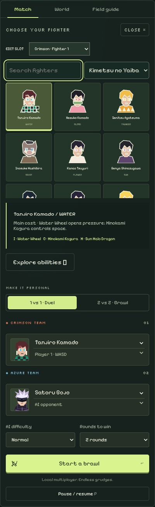
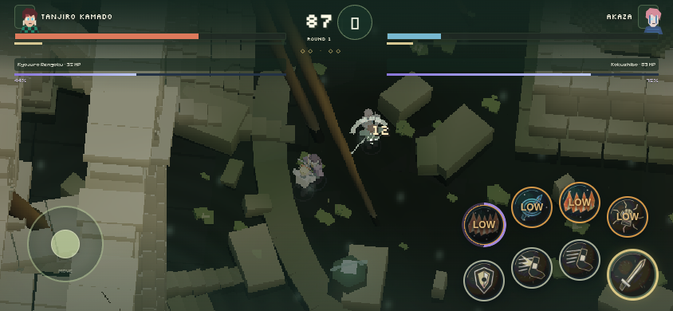

# Kimetsu no Yaiba roster

25 additional playable fighters bring the roster to 36. Open **Fighters / Choose fighters**, set the collection to **Kimetsu no Yaiba**, then select a team slot and a character. Search accepts full or partial names. Hashira and Upper Moons also have separate filters. All four native team selectors contain the same roster.

## Included fighters and abilities

Six leads, nine Hashira, Muzan and nine Upper Moons are included. Gyutaro and Daki are separate fighters sharing Upper Six; Nakime and Kaigaku cover replacement Upper Four and Six. Hantengu's manifestations and alternate transformations are represented through abilities, not additional selectable forms.

| Fighter | Group | Signature 1 | Signature 2 | Ultimate |
| --- | --- | --- | --- | --- |
| Tanjiro Kamado | Main cast | Water Wheel | Hinokami Kagura | Sun Halo Dragon |
| Nezuko Kamado | Main cast | Exploding Blood | Claw Rush | Crimson Blood Burst |
| Zenitsu Agatsuma | Main cast | Thunderclap and Flash | Rice Spirit | Flaming Thunder God |
| Inosuke Hashibira | Main cast | Piercing Fangs | Crazy Cutting | Devouring Rush |
| Kanao Tsuyuri | Main cast | Crimson Hanagoromo | Peonies of Futility | Vermilion Eye |
| Genya Shinazugawa | Main cast | Nichirin Shot | Flesh Gun | Blood Demon Barrage |
| Giyu Tomioka | Hashira | Water Surface Slash | Flowing Dance | Dead Calm |
| Shinobu Kocho | Hashira | Butterfly Dance | Bee Sting | Centipede Zigzag |
| Kyojuro Rengoku | Hashira | Rising Scorching Sun | Flame Tiger | Ninth Form: Rengoku |
| Tengen Uzui | Hashira | Roar | Resounding Slashes | String Performance |
| Mitsuri Kanroji | Hashira | Shivers of First Love | Love Pangs | Catlegged Winds of Love |
| Muichiro Tokito | Hashira | Sea of Clouds | Shifting Flow Slash | Obscuring Clouds |
| Gyomei Himejima | Hashira | Serpentinite Bipolar | Upper Smash | Arcs of Justice |
| Sanemi Shinazugawa | Hashira | Dust Whirlwind Cutter | Black Wind Mountain Mist | Idaten Typhoon |
| Obanai Iguro | Hashira | Winding Serpent Slash | Venom Fangs | Slithering Serpent |
| Muzan Kibutsuji | Demons | Barbed Whips | Black Blood Brambles | Demon King Onslaught |
| Kokushibo | Upper Moons | Evening Palace | Calamitous Eddy | Moonbow Half Moon |
| Doma | Upper Moons | Frozen Lotuses | Crystalline Divine Child | Rime Water Lily |
| Akaza | Upper Moons | Air Type | Disorder | Annihilation Type |
| Hantengu | Upper Moons | Weeping Spears | Thunder Drums | Wood Dragon Menace |
| Gyokko | Upper Moons | Thousand Needle Fish | Water Prison Pot | Killer Fish Scales |
| Gyutaro | Upper Moons | Blood Sickles | Rampant Arc Rampage | Rotating Circular Slashes |
| Daki | Upper Moons | Obi Slash | Eight-Layered Obi | Sash Maelstrom |
| Nakime | Upper Moons | String Resonance | Shifting Rooms | Infinity Castle |
| Kaigaku | Upper Moons | Dark Thunder | Thunder Swarm | Rumble and Flash |

## Presentation and combat

The models are original procedural interpretations on the shared 18-bone rig. Signature details include Tanjiro's checkered haori and earrings, Nezuko's bamboo, Inosuke's boar mask, Rengoku's flame hem, Tengen's gems and paired blades, Obanai's snake, Gyomei's beads and flail, Kokushibo's six eyes, Akaza's markings, Doma's fans and Nakime's biwa. Clothing, props and portraits are generated locally; there are no GLB downloads or external image requests.

Each fighter uses the established light combo, heavy charge, guard/parry, dodge, dash, two skills and ultimate system. Skills use tuned arc, line, projectile, ground-field, radial and rush attacks with distinct labels, palettes and illustrated effect motifs. These are arena-game adaptations: named abilities do not introduce new terrain manipulation, persistent independent summons or cinematic transformations. Stats are gameplay tuning, not canonical power rankings.

The asset bundle contains 113 UI icons, 124 VFX flipbooks and bindings for 252 registered moves. The 25 new fighters contribute 75 icons and 75 flipbooks. All are embedded in the offline HTML. Arcade reads the roster size and now runs 35 encounters.

## Verification

- `npm test`: registry timing/contact, resource gates, deterministic replay and 1,750 seeded matches with no stuck matches.
- `node tests/moba.cjs`, `python3 tests/skill-assets.py`, `python3 tests/vfx-assets.py`: icon uniqueness, binding resolution, alpha/gutters and frame metadata.
- `npm run test:kimetsu`: exact 25 IDs, all four slots, Hashira/Upper Moon filters, search/selection, 125 attack poses across the new rigs, and four new fighters in mobile Drowned Sanctuary combat.
- `npm run test:browser`: 36 rigs/180 poses, offline loading, mode progression including 35 Arcade stages, keyboard and mobile overflow.
- `node tests/moba-browser.cjs`: 108 signature button releases, drag aim, multi-touch, cancellation, preview and HUD state.
- `node tests/deployment.cjs`: isolated dependency-free Vercel build, HTTP 200, 36 roster tiles, all 124 textures, no external runtime asset requests.

Browser tests use desktop Chromium with SwiftShader. Real-phone frame rates and competitive matchup balance have not been established. Procedural accessories can overlap during extreme poses.

