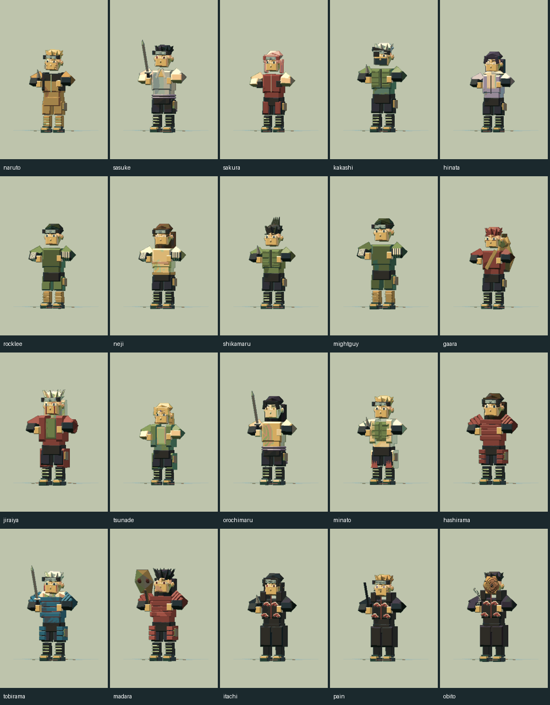
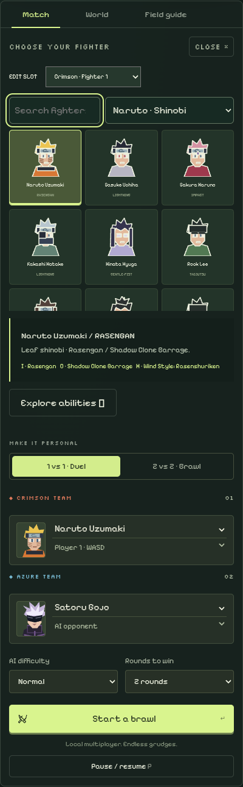
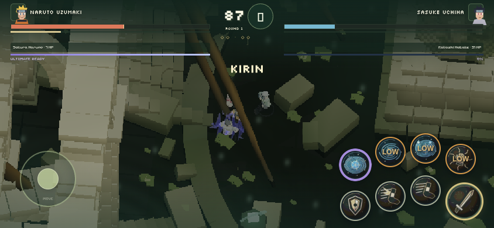

# Naruto · Shinobi roster

Twenty fighters from Naruto/Shippuden join the existing 46-character roster, for 66 total. The pack includes Team 7, Leaf martial artists, Gaara, the Sannin, historic Hokage and prominent antagonists. Each character occupies one slot; alternate ages/forms and Boruto characters are not separate entries.

Open **Fighters → Naruto · Shinobi**, select a team slot and choose a fighter. Search accepts full or partial names. All four team dropdowns also include the pack. It works in 1v1, 2v2, Training and Drowned Sanctuary with the established keyboard, controller and touch controls.

| Fighter | Group | Signature 1 | Signature 2 | Ultimate |
| --- | --- | --- | --- | --- |
| Naruto Uzumaki | Leaf shinobi | Rasengan | Shadow Clone Barrage | Wind Style: Rasenshuriken |
| Sasuke Uchiha | Leaf shinobi | Chidori | Fire Style: Fireball | Kirin |
| Sakura Haruno | Leaf shinobi | Cherry Blossom Impact | Ground Fracture | Strength of a Hundred |
| Kakashi Hatake | Leaf shinobi | Lightning Blade | Lightning Hound | Kamui |
| Hinata Hyuga | Leaf shinobi | Twin Lion Fists | Eight Trigrams Air Palm | Eight Trigrams Sixty-Four Palms |
| Rock Lee | Leaf shinobi | Leaf Hurricane | Primary Lotus | Hidden Lotus |
| Neji Hyuga | Leaf shinobi | Eight Trigrams Air Palm | Eight Trigrams Rotation | Eight Trigrams Sixty-Four Palms |
| Shikamaru Nara | Leaf shinobi | Shadow Possession | Shadow Strangle | Shadow Stitching |
| Might Guy | Leaf shinobi | Dynamic Entry | Daytime Tiger | Night Guy |
| Gaara | Sand shinobi | Sand Coffin | Sand Shower | Imperial Sand Burial |
| Jiraiya | Sannin | Rasengan | Fire Style: Flame Bomb | Sage Art: Goemon |
| Tsunade | Sannin | Heavenly Foot of Pain | Heavenly Spear Kick | Hundred Healings Strike |
| Orochimaru | Sannin | Striking Shadow Snake | Wind Style: Great Breakthrough | Eight Branches |
| Minato Namikaze | Legends | Flying Raijin Strike | Rasengan | Yellow Flash Barrage |
| Hashirama Senju | Legends | Wood Dragon | Deep Forest Emergence | True Several Thousand Hands |
| Tobirama Senju | Legends | Water Dragon | Water Severing Wave | Tandem Explosive Tags |
| Madara Uchiha | Legends | Fire Style: Majestic Flame | Uchiha Reflection | Perfect Susanoo |
| Itachi Uchiha | Akatsuki | Fire Style: Fireball | Amaterasu | Totsuka Blade |
| Pain | Akatsuki | Almighty Push | Universal Pull | Planetary Devastation |
| Obito Uchiha | Akatsuki | Kamui Strike | Fire Style: Bomb Blast Dance | Kamui Vortex |

## Models and combat

The original procedural models share the 18-bone IK rig and instanced body rendering. Distinguishing details include forehead protectors, Naruto's whisker marks, Kakashi's face mask, Hyuga pale eyes, Lee/Guy's bowl cuts and leg wraps, Shikamaru's ponytail, Gaara's gourd, Jiraiya's scroll, Tsunade's forehead seal, the Akatsuki cloud coats, Pain's piercings, Obito's spiral mask and the historic shinobi armor.

Signatures use visible chakra/casting poses; Naruto's Shadow Clone Barrage manifests temporary translucent doubles, Itachi/Madara's ultimates show chakra ribs, and Lee/Guy animate kick attacks. Kunai shrink away during casts and return afterward. Temporary visuals are cleared on recovery and cannot independently deal damage.

Each fighter has three light-combo stages, a charged heavy, two signature skills and an ultimate. Projectile, line, arc, radial, field and multi-pulse attacks share the existing deterministic collision/resource rules. Named jutsu are arena-game adaptations: clones do not run independent AI, Kamui does not create another map, and transformations are not persistent form-switching systems. Stats are gameplay tuning rather than canonical power rankings.

The pack contributes 60 illustrated icons and 60 eight-frame RGBA flipbooks. The complete offline build contains 203 icons, 214 effect sheets and bindings for 462 moves. Arcade derives its length from the roster and now has 65 opponents.

## Validation

- `npm test`: all 462 moves, contact timing, resource gates, determinism, existing arena/team checks and 3,250 seeded roster matches with no stuck matches.
- `node tests/moba.cjs`, `python3 tests/skill-assets.py`, `python3 tests/vfx-assets.py`: asset mappings, distinct signature images, nonblank frames, alpha gutters, palette error and exact UVs.
- `npm run test:naruto`: exact 20 IDs, all four slots, preservation of the other collection filters, 20 rigs/100 poses, clone/chakra visibility and recovery reset, mobile Team 7 sanctuary combat, plus 65-opponent Arcade progression using explicit victory fixtures.
- `node tests/moba-browser.cjs`: 198 touch signature releases, multi-touch aiming, cancellation, previews and HUD states across all 66 fighters.
- `node tests/deployment.cjs`: isolated dependency-free Vercel build, HTTP 200, all 214 textures and 66 roster tiles, no runtime asset requests or browser errors.

Browser checks use desktop Chromium/SwiftShader, not physical-phone performance measurements. The earlier full 36-fighter browser report is historical; focused release reports cover the new pack and integrations.

