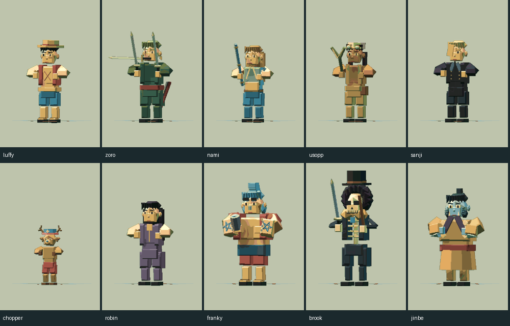
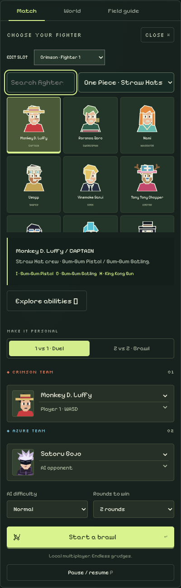
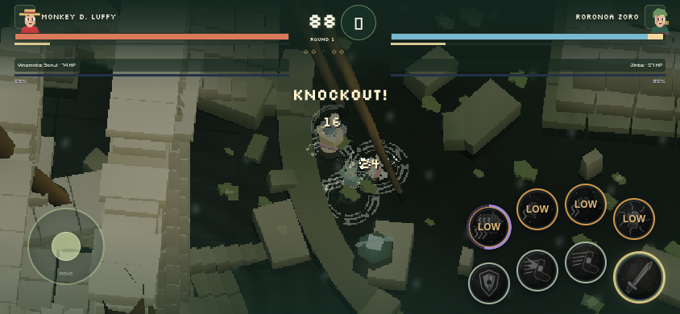

# One Piece · Thousand Sunny crew

The pack adds the ten Straw Hat crew members to the existing 36 fighters, for 46 total. It includes Jinbe and excludes temporary passengers, allies, rival pirates and alternate-form roster duplicates.

Open **Fighters → One Piece · Straw Hats**, choose the team slot, then pick a character. Search accepts full or partial names. All four native team dropdowns also have a One Piece group; keyboard, controller and mobile play use the existing controls.

| Fighter | Crew role | Signature 1 | Signature 2 | Ultimate |
| --- | --- | --- | --- | --- |
| Monkey D. Luffy | Captain | Gum-Gum Pistol | Gum-Gum Gatling | King Kong Gun |
| Roronoa Zoro | Swordsman | Oni Giri | 1080 Pound Phoenix | Three Thousand Worlds |
| Nami | Navigator | Thunderbolt Tempo | Thunder Lance Tempo | Zeus Thundercloud |
| Usopp | Sniper | Green Star: Skull Bombgrass | Green Star: Sargasso | Firebird Star |
| Vinsmoke Sanji | Cook | Diable Jambe | Collier Strike | Ifrit Jambe |
| Tony Tony Chopper | Doctor | Heavy Gong | Cloven Palm | Monster Point Slam |
| Nico Robin | Archaeologist | Treinta Fleur: Clutch | Mil Fleur: Gigantesco Mano | Demonio Fleur |
| Franky | Shipwright | Weapons Left | Strong Right | Radical Beam |
| Brook | Musician | Soul Solid | Soul Parade | Soul King Requiem |
| Jinbe | Helmsman | Five Thousand Brick Fist | Water Shot | Vagabond Drill |

## Models and combat

The ten original procedural models use the shared 18-bone IK rig and instanced body rendering. Identifying features include Luffy's straw hat, Zoro's three swords, Nami's Clima-Tact, Usopp's long nose/goggles/slingshot, Sanji's suit and kick poses, Chopper's antlers and medical hat, Robin's long hair and temporary flower hands, Franky's metal arms, Brook's afro/skull/top hat/cane, and Jinbe's blue skin, tusks and patterned robe.

Luffy's arm extends during signature attacks and returns to normal afterward. Sanji's attacks animate the kicking foot and its trail; Robin's extra hands appear only during signature attacks. These visual elements do not independently apply damage. Each fighter has a three-stage light combo, heavy attack, two signature skills and an ultimate with deterministic costs, cooldowns and hit timing. Abilities use the established projectile, arc, line, field and radial mechanics. Named transformations are arena ability adaptations, not separate form-switching systems. Visual heights and stats are tuned for the arena rather than canonical size/power comparisons.

The pack adds 30 original icon illustrations and 30 eight-frame RGBA effect flipbooks. The complete offline build embeds 143 icons, 154 VFX sheets and bindings for 322 moves; there are no runtime art downloads. Arcade derives its length from the roster and now has 45 opponents.

## Validation

- `npm test`: all 322 moves, timing, contact, resource gates, replay determinism, 32 seeded arena/team checks and 2,250 roster matchup simulations with no stuck matches.
- `node tests/moba.cjs`, `python3 tests/skill-assets.py`, `python3 tests/vfx-assets.py`: all icon/effect bindings, distinct signature assets, transparency, palette error and atlas gutters.
- `npm run test:one-piece`: exact ten-member roster, all four slots, existing Kimetsu/original filters, ten models/50 attack poses, temporary visual reset and mobile 2v2 sanctuary combat. The separate progression check uses explicit forced-victory fixtures to verify 45 different opponents, no self-match and the Arcade terminal state.
- `node tests/moba-browser.cjs`: 138 signature touch releases, multi-touch aiming, cancellation, preview and HUD states across the full roster.
- `node tests/deployment.cjs`: isolated Vercel build, HTTP 200, 46 fighters, all 154 textures, no external asset requests or browser errors.

Browser checks use Chromium/SwiftShader. Physical phone performance and competitive balance still require hands-on playtesting. The previous full 36-fighter regression report is retained; current focused release reports are `one-piece-browser-results.json`, `roster-progression-results.json` and `moba-browser-results.json`.

