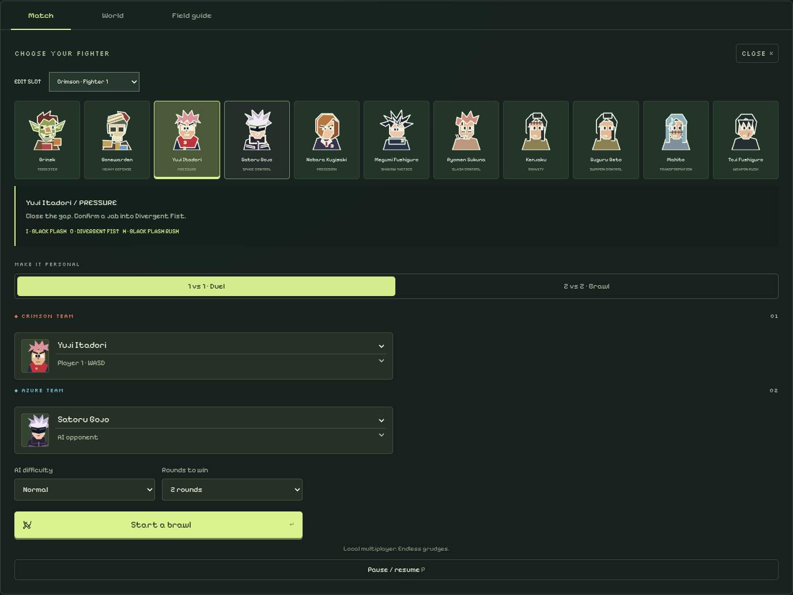
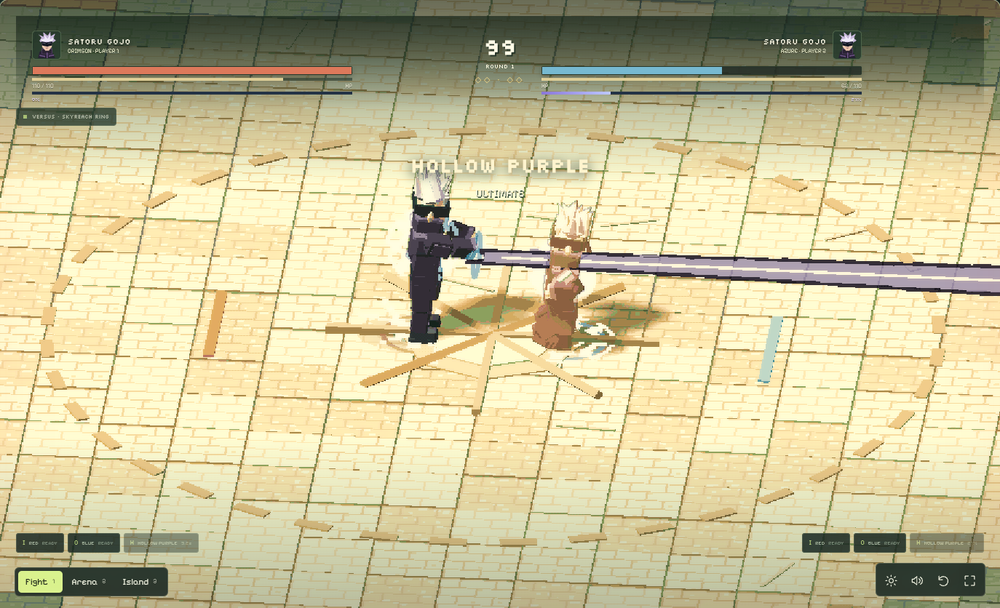
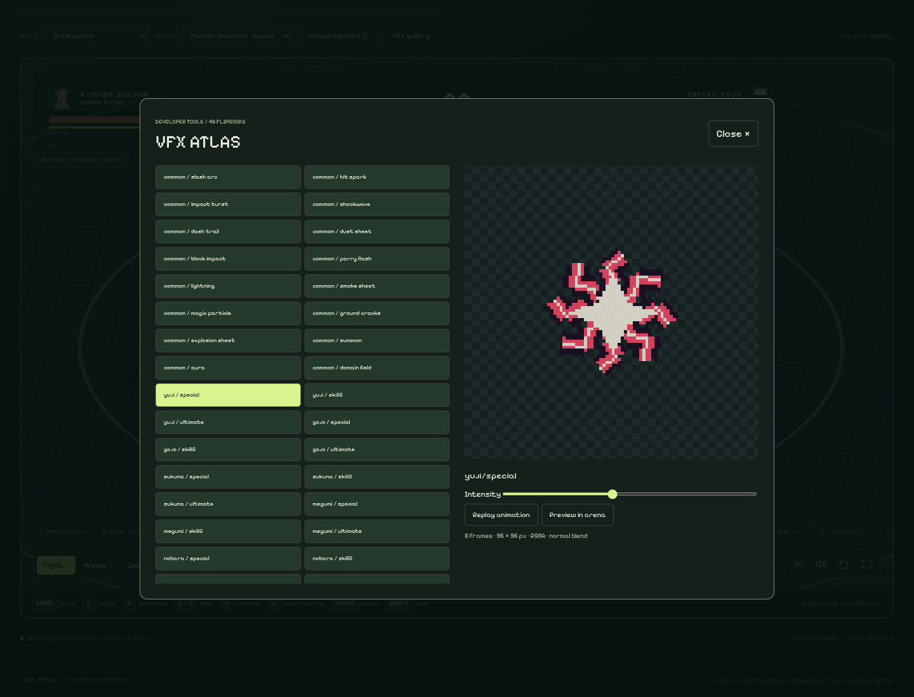

The existing eleven-fighter game had one signature special per fighter, no ultimate resource or skill cooldowns, and combat presentation embedded in a single large HTML file. Combat Reforged adds a data-driven 77-attack registry, two signatures and an ultimate for every fighter, and explicit defensive/cancel/resource rules while preserving the fixed 60 Hz simulation, island, roster and offline play.

- Add charged heavies, five-frame parries, counter windows, confirmed-hit recovery cancels, dash, combo scaling and forced knockdown. Projectiles use swept collision; VFX cannot apply damage.
- Generate and commit 49 original transparent PNG flipbooks with a manifest, event-driven pooled VFX renderer and replayable in-game gallery. Add layered audio, directional feedback and separate accessibility/audio controls.
- Preserve 1v1/2v2; add local duel, ten-encounter Arcade, five-wave Survival and Training with dummy settings, hitboxes, frame data, statistics and resource testing. Moonlit Sanctum adds sealed boundaries alongside the open Skyreach ring.
- Add compact skill/ultimate HUD, on-demand fighter selection, responsive touch controls, phase-aligned poses, cached IK, contact shadows, soft shadows and an animated ocean. Split editable source modules and keep a reproducible single-file offline build.

### Validation

- `npm test`: original mechanics plus all 77 attacks, timing/collision, charge/parry/cancel, stamina/cooldown/ultimate gates, scaling, deterministic replay and 500 roster matches.
- Additional retained simulation suites (`sorcerers`, `new-pair`, `balance`, `matchups`) plus new arena tests: 9,632 seeded matches across the suites, no stuck match.
- `python3 tests/vfx-assets.py`: all 49 RGBA sheets, visible frames, dimensions and four-pixel transparent atlas gutters.
- `tests/reforged-browser.cjs`: eleven rigs, 55 poses, 49 loaded textures, full matches and mode flows, 390px layout; zero browser errors and external requests in offline mode. Progression terminal branches also use explicit result fixtures, separately from full AI matches.
- Retained browser/input/pose suites executed after updating obsolete roster assumptions and portable screenshot paths. `tests/mobile-layout.cjs` verifies seven touch actions and that wrapped navigation clears the toolbar.
- `git diff --check`; rebuilding from source reproduces the committed HTML.

### Review limits

Three.js r128 is retained; WebGL2 is used when available. These are procedural rigs and textured skill effects, not imported character meshes or bespoke multi-shot ultimate cinematics. Domains are timed area attacks, not persistent arenas; summons are attack shapes/projectiles. Cosmetic progression is not included. Initial balance and real GPU/phone performance still need hands-on review; headless software rendering does not establish a 60 FPS hardware benchmark. Remaining limitations are listed in README.

### Screenshots

[Normal combat](https://github.com/xduchuy/Brawl-Island/blob/combat-reforged/docs/screenshots/03-combat.png) · [Moonlit Sanctum](https://github.com/xduchuy/Brawl-Island/blob/combat-reforged/docs/screenshots/06-domain-sanctum.png) · [Mobile](https://github.com/xduchuy/Brawl-Island/blob/combat-reforged/docs/screenshots/09-mobile-combat.png) · [Victory](https://github.com/xduchuy/Brawl-Island/blob/combat-reforged/docs/screenshots/08-victory.png)
